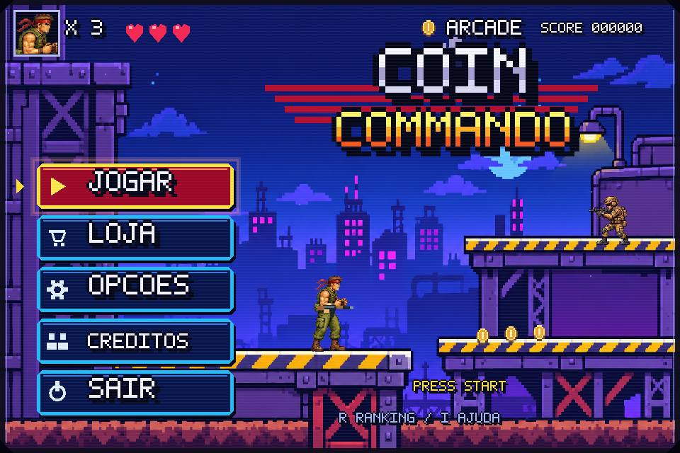

# Coin Commando V3 — Arcade Edition

Jogo de ação e plataforma em Python Arcade, com quatro ambientes, loja de equipamentos, mira livre por mouse, inimigos progressivos e ranking local. Evolução do Coletor de Tesouros para a atividade de POO do IFPR.



Prévia: `docs/screenshots/v3/arcade-preview.mp4`.

## Executar no Windows

Requer Python **3.10 ou superior** e suporte a OpenGL 3.3. Extraia/baixe a pasta inteira, incluindo `assets`.

```powershell
py -m venv .venv
.\.venv\Scripts\python.exe -m pip install -r requirements.txt
.\.venv\Scripts\python.exe main.py
```

No Linux/macOS: `python3 -m venv .venv`, `.venv/bin/python -m pip install -r requirements.txt`, `.venv/bin/python main.py`.

Não é necessário gerar imagens nem ter acesso à internet para jogar depois de instalar as dependências. Não execute `github.py` para iniciar o jogo: esse é o utilitário de commit legado.

## Controles e objetivo

| Tecla | Ação |
|---|---|
| Mouse / J no menu | Selecionar com animação de disparo; abrir a loja inicial |
| A/D ou setas | Andar; direção visual acompanha a mira |
| Movimento do mouse | Mirar livremente em qualquer direção |
| T | Lançar uma faca do estoque comprado |
| Shift | Dash com breve proteção; recarga de 1,8 s |
| 1 / 2 / 3 / 4 | Equipar AK / SMG / escopeta / rifle comprado |
| B | Loja no suprimento inicial ou perto da saída |
| Espaço/W/seta para cima | Pular; sem pulo duplo |
| J/X ou botão esquerdo do mouse | Segurar para disparar na direção da mira |
| R durante a partida | Recarregar a arma equipada; reserva ilimitada |
| P/Esc | Pausar/retomar |
| M na pausa | Voltar ao menu |
| F8 | Alternar sons |
| F9 | Reduzir tremor e flash de tela |
| R no menu/final | Ranking Top 10 |

Recupere **70% das moedas** e alcance a bandeira à direita. As demais são bônus para pontuação e créditos; não é preciso voltar atrás por todas elas. No último setor, também é necessário destruir o guardião. Cada novo setor recupera uma vida, até cinco. Dano consome uma vida e um ponto, com 0,75 s de invulnerabilidade. Moedas valem 1 ou 5 pontos e o dobro em créditos; inimigos rendem pontos multiplicados pelo combo e créditos fixos. Abates dentro de três segundos aumentam o combo, até 4×. A campanha termina na derrota ou após o quarto setor. Digite o nome e pressione Enter para registrar o resultado uma única vez.

## Loja e arsenal

A loja aparece antes da campanha e entre setores. Durante a fase, B abre o suprimento no início ou perto da saída. Enquanto está aberta, combate, recarga e tempo de partida param. A loja é clicável e aplica o impacto visual antes da compra. Equipamentos e créditos duram **uma campanha**; começar outra reinicia o inventário. A pontuação do ranking nunca é gasta.

| Compra | Créditos | Efeito |
|---|---:|---|
| AK-47 inicial | 0 | 30 tiros, intervalo 0,105 s, recarga 1,4 s |
| SMG | 32 | 40 tiros, intervalo 0,065 s, pequena dispersão |
| Escopeta | 46 | 7 cartuchos, cinco projéteis por disparo |
| Rifle de precisão | 68 | 10 tiros, dano 4, perfura dois inimigos |
| 5 facas | 8 | T lança na direção da mira; dano 6; até três alvos |
| Dano | 24 / 38 / 52 | +1 por projétil em todas as armas; máximo 3 |
| Cadência | 22 / 37 | +13% de ritmo por nível; máximo 2 |
| Kit médico | 16 | Recupera 2 vidas; não permite compra com vida cheia |

Armas já compradas não são cobradas novamente. Créditos insuficientes, itens inválidos e upgrades no máximo não alteram o saldo. Começa-se com 16 créditos e sem facas.

## Campanha e novos desafios

1. **Selva em Alerta:** ruínas, patrulhas armadas, minas e barris explosivos.
2. **Rota do Deserto:** pôr do sol industrial, elevações diferentes, drones e soldados de investida.
3. **Fundição Vermelha:** interior de fábrica, plataformas metálicas, faíscas e lasers periódicos.
4. **Código Glacial:** fortaleza nevada, tempestade visual, mais inimigos e chefe que dispara mais rápido abaixo de meia vida.

Emboscadas ocorrem em dois pontos fixos de cada setor, uma vez por ponto; drones surgem longe do jogador. Sentinelas avisam o tiro com `!`. Minas mostram uma área de perigo antes de explodir e são consumidas. Lasers amarelos são aviso; vermelhos causam dano. Barris atingidos explodem e podem ferir o jogador próximo. Use salto, cobertura, dash e a arma adequada.

## Menus e imersão

Menu, loja, ranking, instruções, créditos, resultado e pausa compartilham botões com destaque progressivo ao passar o mouse. Uma seleção dispara som, traçador, faíscas e marca de impacto, aguardando 0,22 s antes da ação. O bloqueio durante esse intervalo evita cliques duplicados. Há entrada em fade, câmera de fundo lenta, partículas e radar no menu. F9 reduz efeitos de tela. A pausa mantém a interface animada sem avançar o combate.

Colisões usam física a 60 passos por segundo, independentemente da frequência de desenho. Efeitos são limitados para evitar crescimento indefinido de partículas/projéteis. Perder o foco da janela pausa e limpa os comandos.

## Requisitos da atividade / localização

| Exigência do PDF | Implementação |
|---|---|
| `PhysicsEnginePlatformer`, gravidade e `can_jump()` | `game.py`, `TelaJogo.load_stage` e `on_key_press` |
| `Bloco(arcade.Sprite)` em `SpriteList` | `game.py`, chão e plataformas |
| `load_spritesheet()` + `get_texture_grid()` | `actors.py`, `Jogador.__init__` |
| Quadros 96×128, idle 0, pulo 1, caminhada 2–9 | `assets/player.png`, 960×128; `tools/pack_sprites.py` |
| Prioridade pulo → idle → caminhada, direção, 100 ms | `actors.py`, `Jogador.update(delta_time)` |
| `SqliteDatabase`, `BaseModel`, `Pontuacao` e campos tipados | `models.py` |
| `__str__`, data/hora padrão | `models.py`, `Pontuacao` |
| Captura do nome via `on_text`/`on_key_press`, `create()` | `game.py`, `TelaGameOver`; trata nome vazio e falha de gravação |
| Top 10 por pontos, consulta única no `__init__` | `game.py`, `TelaRanking`; desempate por menor tempo |
| `enumerate`/`draw_text`, ranking vazio e atalho R | `TelaRanking`, `TelaMenu`, `TelaGameOver` |
| Separação de responsabilidades | modelos, regras, animação, som, efeitos e Views em módulos distintos |

`ranking.db` mantém o esquema e os resultados anteriores do repositório. Os testes usam um banco temporário; não precisam apagar seu histórico. O arquivo do banco precisa estar em uma pasta com permissão de escrita.

## Testes

```bash
python -m pip install pytest
python -m pytest -q
```

Os testes gráficos configuram `ARCADE_HEADLESS=1` e usam o motor Arcade real via EGL. Em Linux, um driver EGL/OpenGL é necessário. São 31 testes: física real, travessia de todas as plataformas, pulo duplo, combate, perfuração sem dano duplicado, perigos telegrafados, campanha completa com lojas, inventário, compras atômicas, mira com câmera, facas, menus clicáveis, seleção por tiro, pausa/foco, recarga, animação, frequência de quadros, nome, inserção única e ranking sem consultas no desenho.

A execução automatizada valida o motor; balanceamento e sensação de combate ainda devem ser experimentados no PC de apresentação.

## Arte e som

Cenários e sprites originais gerados para esta versão com referência à estética arcade fornecida. Os sprites foram empacotados em dimensões exatas para o motor. Não são arquivos extraídos de jogos comerciais. As fontes das imagens estão em `assets/*-source.png` e nos fundos `ruins.png`, `desert.png`, `foundry.png`, `snow.png`. O corpo sem arma foi gerado para permitir desenhar o arsenal separadamente com rotação livre. Os quadros continuam com 96×128 pixels. O tile de pedra também foi gerado e normalizado para 48×48. Áudios PCM originais sintetizados localmente: disparo, impacto, moeda, salto, recarga, explosão e conclusão.

`python tools/build_assets.py` reconstrói tiles/sons e empacota novamente os sprites preservados; `python tools/pack_sprites.py` reempacota apenas os sprites. As imagens prontas já acompanham o projeto.

Desenvolvimento: **Vitor Rufino Brumatti — 3º Info / IFPR**.

## Validação e limites

31 testes passaram em Linux com o Arcade real em EGL; menu, loja e ambientes foram renderizados e revisados visualmente. O Arcade emite avisos de desempenho para `draw_text` (o ranking mantém essa chamada explicitamente exigida pelo PDF). A audição e a experiência de combate no Windows ainda precisam ser verificadas no PC de apresentação.

## V3 — combate legível e apresentação de fliperama

O menu segue a composição da referência fornecida: cidade industrial azul/roxa, logo metálico/dourado no alto, opções em coluna à esquerda, HUD de demonstração, personagem e inimigo animados à direita. O nome Coin Commando foi mantido. Jogar, Loja, Opções, Créditos e Sair são botões reais; setas cima/baixo selecionam e Enter confirma. R continua abrindo o Top 10, e I abre o manual. As opções permitem alternar som, filtro de fliperama e efeitos reduzidos. Clique mantém a animação de disparo/impacto.

Balas do jogador usam amarelo, núcleo claro e contorno escuro; inimigos usam rosa/vermelho e núcleo branco. Rastros são exclusivamente visuais e não aumentam a área de dano. Os impactos produzem faíscas; explosões têm anéis de choque, fumaça em pixels e fragmentos. O filtro CRT tem scanlines, bordas e cantos de gabinete; pode ser desligado em Opções.

Cadência inimiga foi reduzida: soldados agora esperam de 3,0 s no setor 1 a 2,1 s no setor 4 entre tiros (antes 1,8 a 1,05 s). Projéteis inimigos percorrem 3 a 3,75 pixels por passo físico (antes 5,5 a 6,25). O chefe espera 1,9 s e 1,35 s em fúria. Soldados precisam estar virados para o jogador, ter linha de visão livre e manter mira por pelo menos 0,6 s; não atiram através de cobertura. O chefe gira visualmente e espera antes de disparar.

Drones não disparam balas: soltam granadas quando estão acima e próximos do jogador. A granada cai com gravidade e para ao tocar uma plataforma; depois de pousar, avisa por aproximadamente 0,95 s antes de explodir. Área de risco e luz piscante mostram o perigo. Pode ser destruída com um tiro. Cada drone espera pelo menos 3,5 s entre lançamentos e existem no máximo oito granadas ativas. A explosão é processada uma única vez.

Os testes adicionais cobrem tiros pelas costas, orientação frontal, cadência, cobertura, queda/pouso/fusível único, drones sem balas, opções funcionais e renderização com tiros/facas/granadas/impactos ativos.
